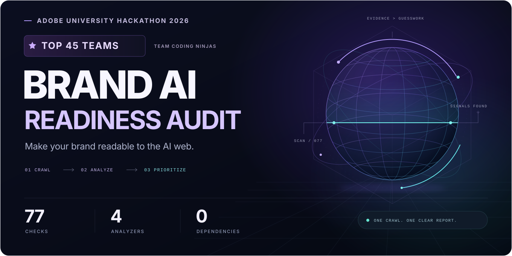
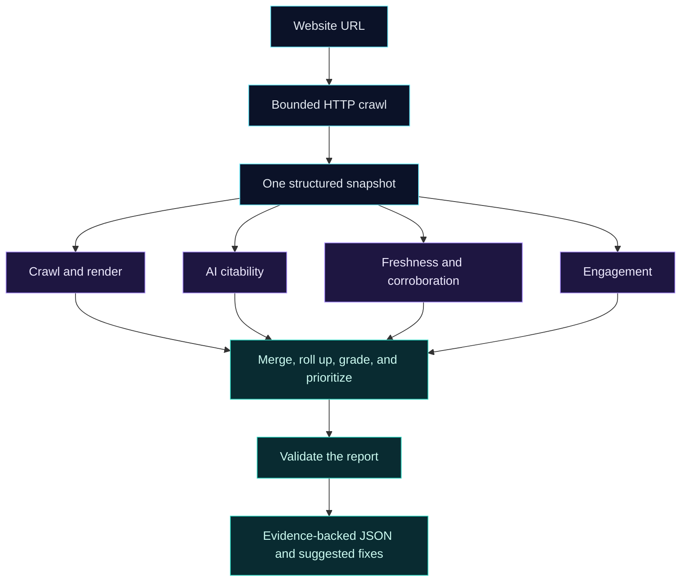

# Adobe University Hackathon 2026 · Top 45 Teams



<p align="center">
  
  
  
  
</p>

<p align="center">
  <strong>One crawl. Four perspectives. One evidence-backed report.</strong><br />
  Find what stops AI assistants discovering, reading, and citing a brand —<br />
  and what stops people engaging when they arrive.
</p>

<p align="center">
  <a href="#run-your-first-audit">Quickstart</a> ·
  <a href="#how-it-works">Architecture</a> ·
  <a href="skills/audit-orchestrator/references/example-report.json">Example report</a> ·
  <a href="docs/TECHNICAL_GUIDE.md">Technical guide</a>
</p>

---

## The hackathon project

Built for **Adobe University Hackathon 2026**, where **Team Coding Ninjas** was selected among the **Top 45 teams**. The competition recorded **300,000+ participant registrations** ([event listing](https://unstop.com/hackathons/adobe-university-hackathon-2026-adobe-1715333)).

The challenge: help brands understand their visibility in an agent-driven web. This project turns that question into a working, repeatable audit. It combines a bounded HTTP crawler, four specialized analyzers, and a report-composition engine in a **Python standard-library-only Agent Skills marketplace**.

It runs from the command line or an agent harness. The core audit needs **no API keys, model downloads, browser binary, database, or third-party Python packages**.

## What it finds

| Audit pillar | The question | Examples of evidence |
| :--- | :--- | :--- |
| **Crawl & render** | Can an assistant reach and read the page? | Robots rules, bot walls, redirects, canonicals, indexing signals, likely client-render gaps |
| **AI citability** | Can it extract a fact and attribute it correctly? | Structured data, entity identity, quotable facts, attribution, table labeling |
| **Freshness & corroboration** | Are the facts current and consistent? | Publication dates, stale text, sitemap timestamps, conflicting contact details |
| **Engagement** | Can a visitor find the next useful step? | Calls to action, navigation, broken links, dead ends, forms, mobile viewport, alt text |

**77 checks** feed a common result contract. A finding needs supporting evidence; unavailable evidence is recorded as a limitation rather than treated as a failure.

## How it works



The orchestrator crawls the site once. Four process-isolated analyzers run concurrently over the same snapshot, without making their own network requests. The composer merges duplicates, folds symptoms into root causes, applies a central severity policy, and produces a deterministic report order.

| Engineering choice | Why it matters |
| :--- | :--- |
| **Shared snapshot** | Every analyzer reasons over the same observations; pages are not re-fetched for each pillar. |
| **Bounded crawler** | Page, depth, time, response-size, and rate limits keep work finite; robots rules and declared crawl delays are respected. |
| **Failure isolation** | Analyzer failures become recorded limitations, allowing the remaining results to be composed. |
| **Deterministic composition** | Findings are merged, graded, and sorted centrally before receiving stable IDs. |
| **Report validation** | Schema checks and deterministic repair make the output easier for downstream tools to consume. |
| **Agent-ready remediation** | Findings include verification guidance and fix prompts that fence scraped text as untrusted data. |

## Run your first audit

**Requirements:** Python 3.9+ and HTTP access to the website being audited.

```bash
git clone https://github.com/OMIZOOMI/brand-ai-readiness-audit.git
cd brand-ai-readiness-audit

python3 skills/audit-orchestrator/scripts/run_audit.py \
  --url https://example.com \
  --out report.json
```

Save the reusable snapshot and context for an optional agent review:

```bash
python3 skills/audit-orchestrator/scripts/run_audit.py \
  --url https://example.com \
  --out report.json \
  --snapshot-out snapshot.json \
  --agent-context-out agent-context.json
```

| Option | Default | Purpose |
| :--- | :--- | :--- |
| `--max-pages` | `20` | Base page-sampling limit |
| `--max-depth` | `2` | Link-discovery depth |
| `--budget` | `240` seconds | Overall audit budget |
| `--timeout` | `8` seconds | Request timeout |
| `--rate` | `2` requests/second/host | Per-host request rate |

The crawler can adaptively expand its sample when the remaining budget permits. See the [runtime policy](skills/audit-orchestrator/references/runtime-and-safety.md) for the complete limits.

## A report you can act on

The [complete example report](skills/audit-orchestrator/references/example-report.json) shows the actual output contract. Each finding connects a specific observation to its impact and a suggested action.

| Report component | What it provides |
| :--- | :--- |
| **Summary** | Finding counts by severity |
| **Findings** | Affected pages, evidence, impact, confidence, and suggested actions |
| **Root-cause analysis** | Related defects and the order in which to address them |
| **Coverage & limitations** | What passed, what was inapplicable, and what could not be evaluated |
| **Audit metrics** | Runtime and work completed during that audit |
| **Report validation** | The output-validation result |

The tool emits recommendations. It does not edit or deploy changes to the audited website.

## Test, inspect, package

The test suite exercises synthetic websites and transport behavior without relying on live third-party sites. It covers analyzers, report composition, crawler limits, partial failures, concurrent audits, and remediation-prompt handling.

**Verified locally on 22 October 2026:** 325 tests run, 324 passed, and one optional specification-validator test skipped. Marketplace validation also passed.

```bash
# Run the test suite.
python3 -m unittest discover -s tests -v

# Validate the manifest, skill structure, credentials scan, and size limits.
python3 tools/package_submission.py --check-only

# Benchmark against synthetic fixture sites.
python3 tools/benchmark.py --runs 3

# Build the hackathon submission ZIP.
python3 tools/package_submission.py
```

## Explore the source

```text
brand-ai-readiness-audit/
├── marketplace.json              # Five skills, one entrypoint
├── skills/
│   ├── audit-orchestrator/        # Crawl, compose, validate, report
│   ├── crawl-render-audit/        # Access and response readability
│   ├── ai-citability-audit/       # Facts and entity identity
│   ├── freshness-corroboration/   # Currency and consistency
│   └── engagement-audit/          # Visitor experience
├── tests/                        # Fixtures and regression suite
├── tools/                        # Validation, benchmarking, packaging
├── docs/TECHNICAL_GUIDE.md         # Original technical documentation
└── REQUIREMENTS.md               # Challenge requirements
```

<details>
<summary><strong>Deep-dive documentation</strong></summary>

- [Technical guide](docs/TECHNICAL_GUIDE.md)
- [Marketplace manifest](marketplace.json)
- [Composition policy](skills/audit-orchestrator/references/composition.md)
- [Severity model](skills/audit-orchestrator/references/severity-model.md)
- [Report schema](skills/audit-orchestrator/references/report-schema.md)
- [Snapshot schema](skills/audit-orchestrator/references/snapshot-schema.md)
- [Semantic-review boundary](skills/audit-orchestrator/references/semantic-review.md)
- [Challenge requirements](REQUIREMENTS.md)

</details>

## Scope

- The core audit inspects HTTP responses; it does not execute JavaScript or render pages in a browser.
- Findings describe the sampled pages, not an exhaustive scan of every URL. Subdomains are audited separately.
- Some semantic checks use English-language heuristics. Off-site corroboration requires separately supplied research capability or data.
- The report identifies technical opportunities; it does not measure or guarantee placement in AI-generated answers.

## License

[Apache License 2.0](LICENSE). Hackathon project; not an official Adobe product.
